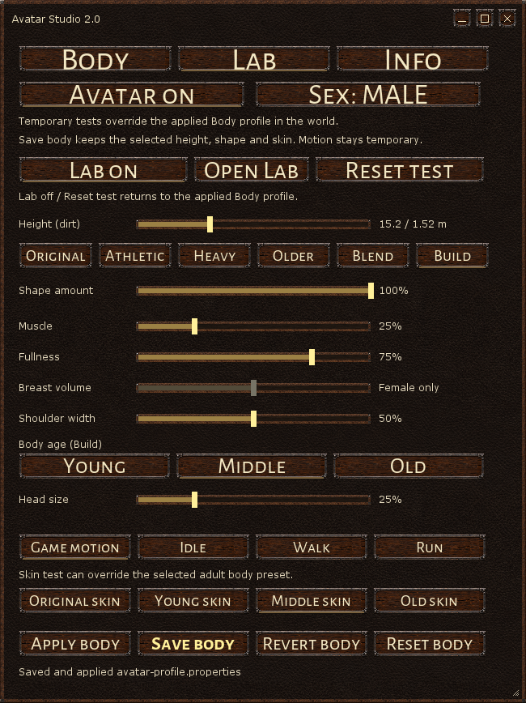
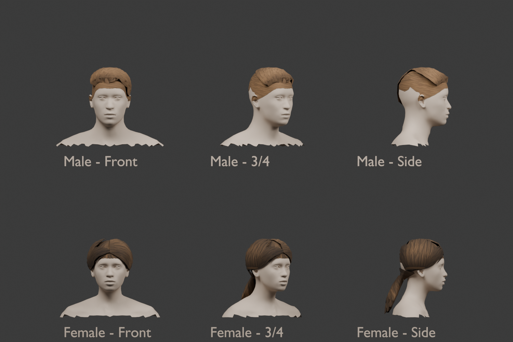

# Avatar 2.0

A client mod for **Wurm Unlimited** with customizable male and female avatars,
matching portraits, fitted native hairstyles and new idle, walk and run animations.

**Current release: 0.15.2** · [Download the installable ZIP](https://github.com/chamomilo/Wurm-avatar-2.0/releases/latest)



*Avatar Studio's native Lab view. This interface preview uses the mod's actual
controls with an offline rendering backend.*

## Customize your avatar

- Adjust height from **1.3 to 2.0 metres**, head size and shoulder width.
- Set muscle and fullness independently, with an additional female breast-volume control.
- Choose **Young, Middle or Old** adult body and skin presets.
- Use Original, Athletic, Heavy and Older shapes, or blend their contributions.
- Preview changes immediately, save your appearance, or return to the saved profile.
- Keep Wurm's hairstyle and colour choices. Hair follows the head, body shape and height.
- Try poses and motion in the temporary Lab, then reset to your saved appearance.



*Offline model preview of the fitted native hairstyles and shaped hairline.
The game supplies its own hairstyle meshes and textures at runtime.*

[View all hairstyle previews](docs/images/hairstyles.png) · [View adult body presets](docs/images/body-age.png)

## Install or update

Requires Wurm Unlimited with a compatible **Wurm Client Mod Launcher**.
The release contains the mod; it does not include the game or mod launcher.

1. Close Wurm Unlimited and back up your existing Avatar profile, normally
   `WurmLauncher/mods/avatar2/avatar-profile.properties`.
2. Download **avatar2-0.15.2.zip** from [Releases](https://github.com/chamomilo/Wurm-avatar-2.0/releases/latest).
   Use the installable ZIP rather than GitHub's source-code download.
3. Extract the ZIP into **WurmLauncher**, merging its `mods` folder. Replace the
   existing `mods/avatar2.properties` when updating. Keep your saved profile.
4. Start the client. Open **Avatar Studio** through HUD Settings, or enter
   `/avatar2` in the F1 console.

The installer contains exactly four files:

```text
README.txt
mods/avatar2.properties
mods/avatar2/avatar2-0.15.2.jar
mods/avatar2/avatar2-resources-0.15.2.jar
```

The descriptor points to the matching JAR and resource pack. Old unreferenced
versioned JARs are unnecessary and can be removed manually after a successful
update. Preserve profile files and their backups.

## Use Avatar Studio

**Body** edits preview immediately. **Save body** writes the selected appearance;
**Revert body** restores the last saved profile. **Avatar on/off** switches between
Avatar and the original character model.

**Lab** provides temporary appearance and animation trials. **Reset test** or
**Lab off** returns to the applied Body profile. Saving from Lab keeps its chosen
appearance while animation trials remain temporary. **Open Lab** opens the optional
local browser interface; it runs only when enabled. See the [Lab guide](docs/ANIMATION_LAB.md).

## Settings and language

The embedded **Chamomilo updater 1.5.0** provides a shared mod list and settings
window. Select **Settings** on the Avatar 2.0 card:

| Setting | Applies |
| --- | --- |
| Show Avatar Studio | Immediately; also controls visibility when the HUD is created |
| Avatar profile file | After restarting the client |
| Avatar resource pack | After restarting the client |
| Diagnostic logging | Immediately, subject to the client's log-handler level |

Changes save automatically to `~/.chamomilo/mod-settings/avatar2.properties`.
Only edited values are stored. Leave the resource-pack setting at its release
default to follow future upgrades. Changing the profile path does not move an
existing profile file.

Choose **English, Brazilian Portuguese, German or Russian** in the updater's
shared language selector. Avatar Studio follows that selection. Appearance sliders
and presets remain in Avatar Studio.

## Scope and compatibility

Avatar changes the local character and its portraits on your client. It does not
synchronize appearance with other players or change server movement, skills or
collision. Armour fitting is still in development. Other mods replacing the same
player model or animation hooks may conflict.

First-person and nearby free-look views hide the local head, eyes and hair to
avoid showing their interior. This visibility handling does not prevent a free
camera from passing through the model.

## Build and licenses

[Build instructions](docs/BUILDING.md) · [Third-party assets](docs/THIRD_PARTY_ASSETS.md) · [Changelog](CHANGELOG.md)

Project code: **LGPL-3.0-only**. Body, skin and motion sources have their own
licenses, including CC0 assets from MakeHuman and Quaternius. The embedded
Chamomilo UI fonts use **SIL OFL 1.1**. License notices are included inside the
runtime JARs. Native Wurm assets and proprietary client libraries are not shipped.
